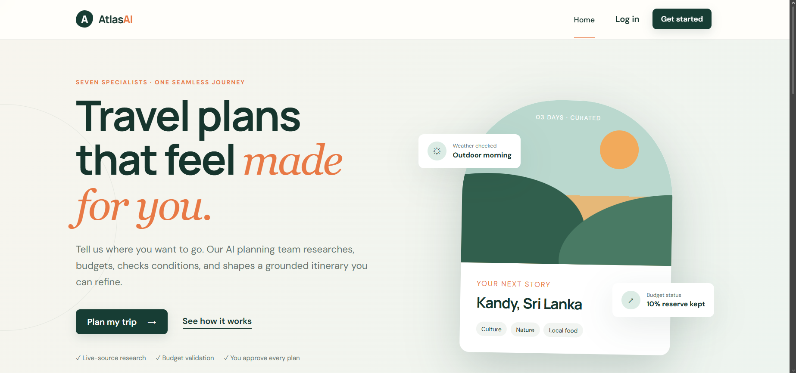
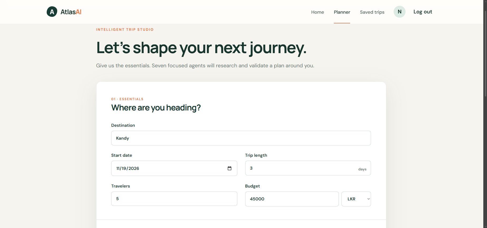
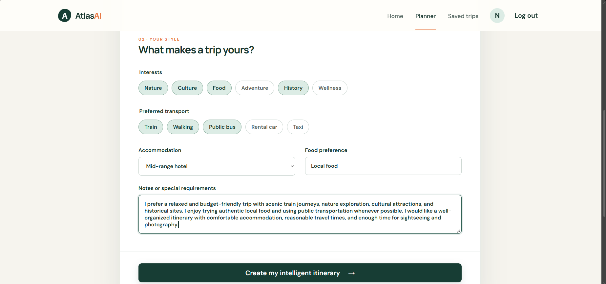
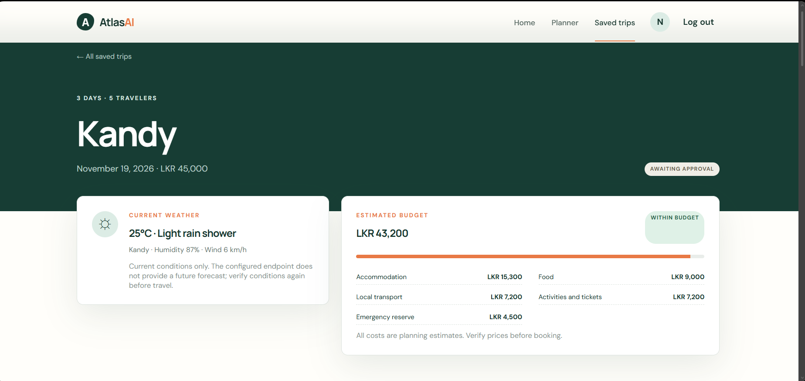
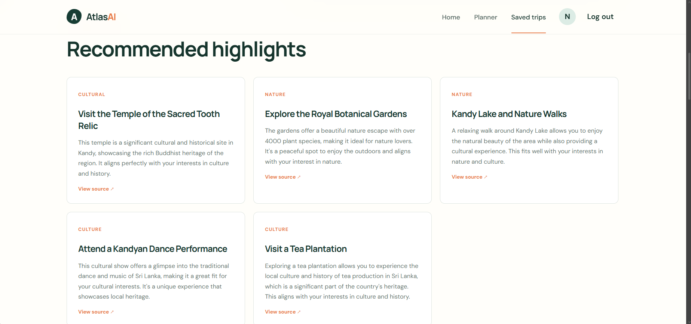
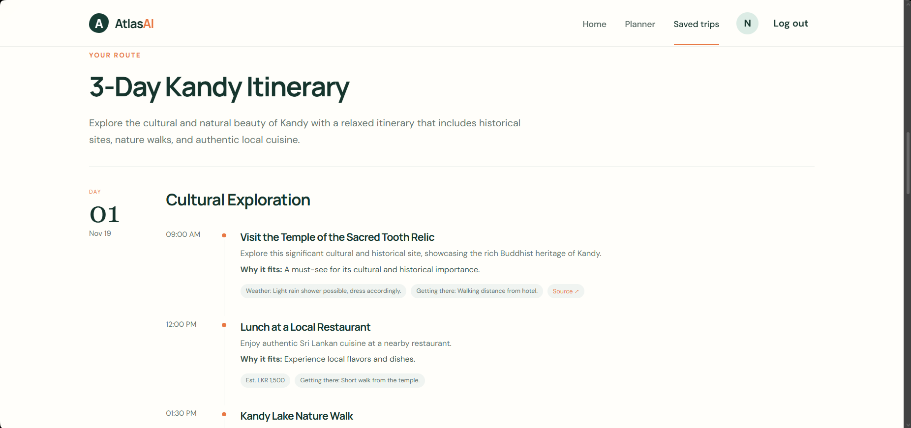

# AtlasAI — AI Smart Travel Planner

AtlasAI is a full-stack, multi-agent travel planning application that creates personalized, weather-aware, and budget-aware itineraries. Seven specialized AI agents collaborate through LangGraph to research destinations, check current conditions, estimate costs, recommend experiences, build day-by-day plans, and validate the final itinerary.

## Features

- Personalized itineraries based on destination, dates, budget, interests, transport, accommodation, and food preferences
- Seven-agent AI workflow with supervision and final-plan validation
- Live destination research with source links
- Current weather insights for the selected destination
- Itemized budget estimates with an emergency reserve
- Tailored cultural, nature, food, and activity recommendations
- Day-by-day itinerary timeline with travel notes and estimated costs
- JWT-based user registration and authentication
- Saved trips, trip details, and profile management
- Responsive React interface and Docker-based deployment

## Multi-Agent Workflow

The LangGraph workflow coordinates these seven specialized agents:

1. **Supervisor Agent** — coordinates the workflow and selects the next agent.
2. **Search Agent** — researches the destination and gathers grounded sources.
3. **Weather Agent** — retrieves and summarizes current weather conditions.
4. **Budget Agent** — creates an itemized estimate within the traveler's budget.
5. **Recommendation Agent** — suggests activities that match the traveler's interests.
6. **Itinerary Agent** — assembles the research into a day-by-day travel plan.
7. **Validator Agent** — checks completeness and sends invalid plans back for revision.

```text
User preferences
      ↓
Supervisor → Search → Weather → Budget → Recommendations → Itinerary → Validator
                                                                      ↓
                                                               Final travel plan
```

## Tech Stack

| Layer | Technologies |
| --- | --- |
| Frontend | React 19, React Router, Axios, Vite |
| Backend | Python 3.11+, FastAPI, Pydantic, Uvicorn |
| AI orchestration | LangGraph, LangChain OpenAI, OpenAI API |
| External data | Tavily Search API, Weatherstack API |
| Database | MongoDB, PyMongo |
| Authentication | JWT, Argon2 |
| Infrastructure | Docker, Docker Compose, Nginx |
| Testing and quality | Pytest, pytest-asyncio, Ruff |

## Screenshots

### Landing Page



### Trip Essentials



### Travel Style and Preferences



### Weather and Budget Summary


### Trip Overview



### Recommended Highlights



### Day-by-Day Itinerary



## Project Structure

```text
Ai-Smart-Travel-Planner/
├── backend/
│   ├── app/
│   │   ├── agents/          # Seven specialized AI agents
│   │   ├── api/v1/          # REST API routes
│   │   ├── graph/           # LangGraph state, nodes, and routing
│   │   ├── models/          # MongoDB models
│   │   ├── repositories/    # Data-access layer
│   │   ├── services/        # Application services
│   │   └── tools/           # LLM, search, weather, and calculator tools
│   ├── scripts/             # Database setup and seed scripts
│   └── tests/               # Backend tests
├── frontend/
│   └── src/
│       ├── api/             # Axios API clients
│       ├── components/      # Reusable UI components
│       ├── context/         # Authentication context
│       └── pages/           # Application pages
├── images/                  # README screenshots
└── docker-compose.yml
```

## Getting Started with Docker

### Prerequisites

- Docker and Docker Compose
- OpenAI API key
- Tavily API key
- Weatherstack API key

### 1. Configure the backend

Copy the example environment file and fill in the required API keys:

```bash
cp backend/.env.example backend/.env
```

```env
OPENAI_API_KEY=your_openai_api_key
OPENAI_MODEL=gpt-4o-mini
TAVILY_API_KEY=your_tavily_api_key
WEATHERSTACK_API_KEY=your_weatherstack_api_key
MONGODB_URI=mongodb://mongodb:27017
MONGODB_DB_NAME=ai_travel_planner
JWT_SECRET_KEY=replace_with_a_secure_random_value
JWT_ALGORITHM=HS256
ACCESS_TOKEN_EXPIRE_MINUTES=60
CORS_ORIGINS=http://localhost:5173,http://localhost:8080
ENVIRONMENT=development
APP_DEBUG=false
```

### 2. Start the application

```bash
docker compose up --build
```

Open the services at:

- Web application: `http://localhost:8080`
- API: `http://localhost:8000`
- Swagger documentation: `http://localhost:8000/docs`
- ReDoc documentation: `http://localhost:8000/redoc`

## Local Development

### Backend

```bash
cd backend
python -m venv .venv
```

Activate the environment on Windows:

```powershell
.venv\Scripts\Activate.ps1
```

Install dependencies and start the API:

```bash
pip install -r requirements.txt
uvicorn app.main:app --reload
```

### Frontend

Create `frontend/.env` from `frontend/.env.example`, then run:

```bash
cd frontend
npm install
npm run dev
```

The Vite development server runs at `http://localhost:5173`.

## Testing

Run backend tests from the `backend` directory:

```bash
pytest
```

Build the frontend for production:

```bash
cd frontend
npm run build
```

## API Overview

The versioned API is available under `/api/v1` and includes endpoints for:

- Authentication
- Users and profiles
- AI travel planning
- Trips and saved itineraries
- User feedback
- Health checks

For full request and response schemas, run the backend and open the interactive Swagger documentation at `http://localhost:8000/docs`.

## Security Notes

- Never commit `.env` files or real API keys.
- Use a long, random `JWT_SECRET_KEY` in production.
- Verify live prices, opening hours, weather conditions, and availability before booking.

## License

This project is intended for educational and portfolio use. Add a license file before distributing or reusing it publicly.
